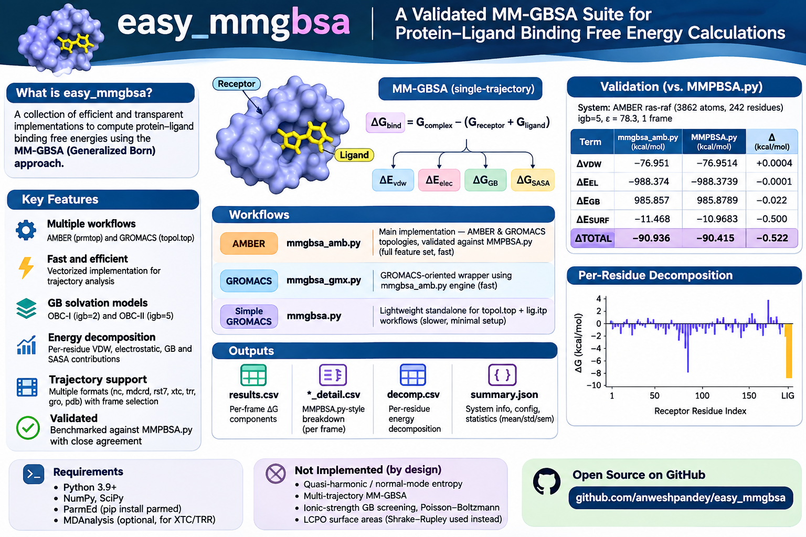

# MM-GBSA Suite



A collection of validated MM-GBSA implementations for computing protein–ligand binding free energies using the Generalized Born (GB) solvation model. All scripts are single-trajectory (bonded terms cancel exactly).

---

## Scripts

| Script | Purpose | Speed | Dependencies |
|--------|---------|-------|--------------|
| **`mmgbsa_amb.py`** | **Main implementation** — AMBER & GROMACS topologies, validated against MMPBSA.py, full feature set | Fast (vectorized) | NumPy, SciPy, ParmEd |
| **`mmgbsa_gmx.py`** | GROMACS-oriented wrapper using `mmgbsa_amb.py` engine | Fast | Same as above |
| **`mmgbsa.py`** | Lightweight standalone for GROMACS `topol.top` + `lig.itp` workflows | Slower (Python loops) | NumPy, SciPy, ParmEd |
| **`mmgbsa_docking.py`** | **Physics-based docking rescoring** — prepares MM parameters for docked poses, runs MM-GBSA | Batch | + OpenFF, PDBFixer, PROPKA |

> **New in v0.2**: `mmgbsa_docking.py` provides a complete physics-based rescoring engine for molecular docking / virtual screening workflows. It handles the critical topology/parameter preparation that docked poses require before MM-GBSA calculation.

---

## Quick Start

### 1. AMBER topology (prmtop) — use `mmgbsa_amb.py`

```bash
# Single frame
python3 mmgbsa_amb.py -t complex.prmtop -c frame.rst7 \
    --ligand-resid-range 167-242 --decomp

# Trajectory (NetCDF, mdcrd, or multi-frame rst7)
python3 mmgbsa_amb.py -t complex.prmtop -c traj.nc \
    --ligand-resid-range 167-242 --decomp -o results.csv --json summary.json
```

### 2. GROMACS topology (topol.top) — use `mmgbsa_gmx.py`

```bash
# GROMACS topology + trajectory (.xtc, .trr, .gro, .pdb, .nc)
python3 mmgbsa_gmx.py -p topol.top -c traj.xtc \
    --lig-resid-range 167-242 -o results.csv --decomp decomp.csv --json summary.json

# With ligand ITP for custom parameters
python3 mmgbsa_gmx.py -p topol.top -l lig.itp -c frame_*.gro \
    --lig-resname LIG -o results.csv --decomp decomp.csv
```

### 3. Simple GROMACS workflow (topol.top + lig.itp) — use `mmgbsa.py`

```bash
python3 mmgbsa.py -p topol.top -l lig.itp -c frame_*.gro \
    -o results.csv --decomp decomp.csv
```

### 4. **Docking Rescoring (NEW)** — use `mmgbsa_docking.py`

```bash
# Install docking dependencies first:
# pip install "easy-mmgbsa[docking]"

# Basic: protein PDB + ligand SDF/MOL2/PDB files (or directory)
python3 mmgbsa_docking.py -p protein.pdb -l ligands.sdf -o results.csv

# With decomposition and JSON summary
python3 mmgbsa_docking.py -p protein.pdb -l poses/ \
    --decomp decomp.csv --json summary.json

# Custom force fields and charge method
python3 mmgbsa_docking.py -p protein.pdb -l ligands.sdf \
    --protein-ff ff19SB --ligand-ff gaff-2.11 --charge-method am1bcc \
    --ph 7.4 -o results.csv --decomp decomp.csv

# Pre-parameterized ligands (MOL2 with GAFF/AM1-BCC charges from antechamber)
python3 mmgbsa_docking.py -p protein.pdb -l ligand.mol2 \
    --prepared-ligand -o results.csv

# **AutoDock Vina PDBQT output** — rescore Vina poses directly!
python3 mmgbsa_docking.py -p protein.pdb -l vina_output/*.pdbqt \
    -o vina_mmgbsa_results.csv --decomp vina_decomp.csv --json vina_summary.json

# Or process entire Vina output directory
python3 mmgbsa_docking.py -p protein.pdb -l vina_output/ \
    -o vina_mmgbsa_results.csv --decomp vina_decomp.csv

# Limit for testing, keep intermediate files
python3 mmgbsa_docking.py -p protein.pdb -l ligands.sdf \
    --max-ligands 10 --keep-intermediate -v
```

**Key point**: Docked poses from docking programs (AutoDock Vina, Glide, GOLD, DOCK, etc.) are **not** ready for MM-GBSA. They lack:
- Proper atom types and charges for the force field
- Protein protonation states at the target pH
- Complete hydrogen atoms
- Consistent topology between protein and ligand

`mmgbsa_docking.py` handles all of this automatically using:
- **Protein**: AMBER ff14SB/ff19SB via `tleap` (or OpenFF fallback)
- **Ligand**: GAFF2 + AM1-BCC charges via OpenFF toolkit (or antechamber fallback)
- **Protonation**: PROPKA for protein, proper tautomers for ligand
- **Structure fixing**: PDBFixer for missing atoms/residues

---

## Common Options (all scripts)

| Option | Description | Default |
|--------|-------------|---------|
| `--igb 2\|5` | OBC-I (2) or OBC-II (5) GB model | 5 |
| `--eps-solvent` | Solvent dielectric constant | 78.3 |
| `--gb-cutoff` | HCT descreening cutoff in Å (0 = disable) | 25 |
| `--radii` | GB radii set: `auto`, `mbondi`, `mbondi2`, `mbondi3`, `bondi` | auto |
| `--sasa-radii` | SASA radii: `bondi` or `gb` | bondi |
| `--probe` | Solvent probe radius (Å) | 1.4 |
| `--surface-tension` | Nonpolar coefficient (kcal/mol/Ų) | 0.0072 |
| `--sasa-points` | Shrake–Rupley sphere points | 240 |
| `--strip` | Comma-separated residue names to strip | WAT,HOH,SOL,... |
| `--no-strip` | Disable solvent stripping | false |
| `--start` `--end` `--stride` | Frame selection (1-based) | all frames |

---

## Ligand Selection

### `mmgbsa_amb.py`
- `--ligand RESNAME` — comma-separated residue names (default: `LIG` only if no other selector)
- `--ligand-resid-range START-END` — 1-based inclusive residue range
- `--ligand-mask ':MASK'` — AMBER-style mask (e.g., `:167-242` or `:LIG`)

**Priority:** explicit `--ligand` > `--ligand-resid-range` / `--ligand-mask` > default `LIG`

### `mmgbsa_gmx.py` / `mmgbsa.py`
- `--lig-resname NAME` — ligand residue name (e.g., `LIG`, `UNL`)
- `--lig-resid-range START-END` — 1-based inclusive range
- `--lig-itp FILE` — optional ligand ITP for parameters; residue name auto-detected

---

## Output Files

| File | Description |
|------|-------------|
| `results.csv` | Per-frame ΔG components: `delta_vdw`, `delta_elec`, `delta_gb`, `delta_sasa`, `delta_total` + complex/receptor/ligand absolute terms + AVERAGE/STDDEV rows |
| `*_detail.csv` | MMPBSA.py-style per-frame breakdown: complex/receptor/ligand VDW, EEL, GB, SASA, 1-4 terms, plus Δ (generated by `mmgbsa_amb.py` / `mmgbsa_gmx.py`) |
| `decomp.csv` | Per-receptor-residue decomposition: `residue_index`, `resname`, `resid`, `vdw`, `elec`, `gb`, `sasa`, `total` + `LIGAND` row + `TOTAL` row |
| `summary.json` | Machine-readable: system info, config, mean/std/sem for all Δ terms, per-subsystem components, decomposition averages (when `--decomp`) |

---

## Physics Implementation (validated in `mmgbsa_amb.py`)

### Nonbonded (gas phase)
- **Lennard-Jones**: AMBER `Rmin` combination rule, `Rmin/2` parameters from topology
- **Coulomb**: AMBER constant `332.0522173 kcal·Å·mol⁻¹·e⁻²`
- **Exclusions**: 1-2, 1-3 from bonds/angles; 1-4 from proper dihedrals (not improper)
- **1-4 scaling**: From topology — AMBER `SCEE`/`SCNB` or GROMACS `[pairs]`/`[defaults]` fudge factors
- **prmtop `EXCLUDED_ATOMS_LIST`**: 1-4 pairs removed from full exclusion, treated with 1-4 scaling

### Generalized Born (OBC)
- **Models**: `igb=2` (OBC-I, α=0.8, β=0, γ=2.909125) and `igb=5` (OBC-II, α=1.0, β=0.8, γ=4.85)
- **Radius offset**: 0.09 Å (ρᵢ = Rᵢ - 0.09)
- **HCT pairwise descreening** with prmtop `SCREEN` array (element fallback: C=0.72, N=0.79, O/H=0.85, F=0.88, P=0.86, S=0.96, else 0.80)
- **rgbmax cutoff**: 25 Å (configurable via `--gb-cutoff`; matches AMBER `mmpbsa_py_energy`)
- **Still formula** for pair energies + self energies
- **kfac** = 332.0522173 × (1/ε_in - 1/ε_out), ε_in=1, ε_out=78.3, no salt

### Nonpolar (SASA)
- **Shrake–Rupley** with Bondi radii, probe=1.4 Å
- **Burial test**: solvent-expanded spheres (rⱼ + probe)
- **Surface tension**: 0.0072 kcal/mol/Ų (AMBER default)
- **Note**: Differs from MMPBSA.py LCPO by ~4.5% in ESURF (0.55% of ΔTOTAL)

### Decomposition (AMBER `idecomp` convention)
- Receptor–ligand pairs: ½ to receptor residue, ½ to `LIGAND` row
- Intra-receptor GB pairs: split between both residues
- GB self/internal desolvation + SASA: assigned to owning residue
- **Sums exactly to ΔG** (residual ~2×10⁻¹¹ kcal/mol)

---

## Validation (mmgbsa_amb.py vs MMPBSA.py)

**System**: AMBER ras-raf (3862 atoms, 242 residues), receptor :1-166, ligand :167-242, 1 frame, igb=5, saltcon=0, ε=78.3

| Term | mmgbsa_amb.py | MMPBSA.py | Difference |
|------|--------------|-----------|------------|
| ΔVDW | -76.951 | -76.9514 | +0.0004 |
| ΔEEL | -988.374 | -988.3739 | -0.0001 |
| ΔEGB | 985.857 | 985.8789 | -0.022 |
| ΔESURF | -11.468 | -10.9683 | -0.500 |
| **ΔTOTAL** | **-90.936** | **-90.415** | **-0.522** |

**Complex 1-4 terms**: match to 4 decimals (895.456 VDW, 8527.283 EEL)

**GROMACS round-trip** (`rasraf.top` + `rasraf.gro`): ΔTOTAL = -90.958 (topology conversion diff only)

**Decomposition**: per-residue VDW/Coulomb match to 0.001 kcal/mol (mdout rounding); GB offset due to MMPBSA.py using `extdiel=80` vs 78.3

---

## Docking Rescoring Workflow (`mmgbsa_docking.py`)

### The Problem: Docked Poses ≠ MM-GBSA Ready

Docking programs output poses with arbitrary atom naming, no partial charges, no force field atom types, and often missing hydrogens. **Running MM-GBSA directly on docked PDBs gives meaningless results.**

### The Solution: Physics-Based Preparation Pipeline

`mmgbsa_docking.py` implements a complete preparation pipeline specifically designed for AutoDock Vina and other docking programs:

```
AutoDock Vina PDBQT poses  +  Original ligand SDF/MOL2 (for chemistry)
            │                              │
            ▼                              ▼
    ┌──────────────────┐            ┌──────────────────┐
    │  PDBQT Parser    │            │  Reference       │
    │  - All MODEL     │            │  Loader          │
    │    blocks parsed │            │  - Bond orders   │
    │  - Energies kept │            │  - Stereochemistry
    └────────┬─────────┘            └────────┬─────────┘
             │                               │
             └──────────────┬────────────────┘
                            ▼
                 ┌──────────────────────┐
                 │  Pose Coordinate     │
                 │  Mapper              │
                 │  - Map PDBQT coords  │
                 │    onto reference    │
                 │  - NO optimization   │
                 │    (preserves pose)  │
                 │  - Add H after map   │
                 └──────────┬───────────┘
                            ▼
                 ┌──────────────────────┐
                 │  Ligand              │
                 │  Parameterization    │
                 │  - GAFF2 + AM1-BCC   │
                 └──────────┬───────────┘
                            ▼
                 ┌──────────────────────┐
                 │  Protein             │
                 │  Preparation         │
                 │  - PDBFixer + PROPKA │
                 │  - tleap (AMBER FF)  │
                 └──────────┬───────────┘
                            ▼
                 ┌──────────────────────┐
                 │  Complex Assembly    │
                 │  - Merge protein +   │
                 │    ligand            │
                 └──────────┬───────────┘
                            ▼
                 ┌──────────────────────┐
                 │  MM-GBSA Engine      │
                 │  - Validated OBC GB  │
                 │    (mmgbsa_amb.py v4)│
                 └──────────┬───────────┘
                            ▼
                       Ranked ΔGbind
```

### Key Features for Docking Rescoring

| Feature | Description |
|---------|-------------|
| **Multi-pose PDBQT** | Parses all `MODEL`/`ENDMDL` blocks from Vina output |
| **Chemical mapping** | Uses original ligand SDF/MOL2 for bond orders & stereochemistry |
| **Pose preservation** | Maps coordinates WITHOUT geometry optimization |
| **Pose selection** | `--pose-mode best|all|ensemble` (top 1, all, or top 5) |
| **Traceability** | Output includes Vina energy & pose index |

### Ligand Parameterization Details

| Method | Description | Requirements |
|--------|-------------|--------------|
| **AM1-BCC** (default) | Semi-empirical QM charges, bond-charge corrections | OpenFF Recharge (OpenEye) or antechamber |
| **AM1-BCCELF10** | AM1-BCC with ELF10 conformational sampling | OpenFF Recharge |
| **Gasteiger** | Fast empirical PEOE charges | RDKit (no QM) |
| **MMFF94** | Merck Molecular Force Field charges | RDKit |

**Recommended**: `am1bcc` with OpenFF Recharge (most accurate, used in SAMPL challenges).

### Protein Preparation Details

| Step | Tool | Purpose |
|------|------|---------|
| Structure fixing | PDBFixer | Add missing atoms, residues, loops |
| Protonation states | PROPKA | Assign His/Cys/Asp/Glu states at target pH |
| Hydrogen addition | PDBFixer/tleap | Add all H atoms with correct geometry |
| Force field | tleap (AMBER) | Assign ff14SB/ff19SB parameters |

### Output Files (Docking Rescoring)

| File | Description |
|------|-------------|
| `results.csv` | Ranked poses: `rank`, `ligand`, `delta_total`, `delta_vdw`, `delta_elec`, `delta_gb`, `delta_sasa` + absolute components + `vina_energy`, `pose_index` |
| `decomp.csv` | Per-residue decomposition for all poses (merged, with `ligand`, `rank` columns) |
| `summary.json` | Machine-readable: config, all results, statistics (best, mean, std) |

---

### Docking Rescoring Example

See [`examples/docking_rescoring_example.md`](examples/docking_rescoring_example.md) for a complete walkthrough with:
- Installation instructions
- Input file preparation
- Command-line options explained
- Output file formats
- Troubleshooting common issues

---

## Docking Rescoring Example

See [`examples/docking_rescoring_example.md`](examples/docking_rescoring_example.md) for a complete walkthrough with:
- Installation instructions
- Input file preparation
- Command-line options explained
- Output file formats
- Troubleshooting common issues

---

## Requirements

- Python 3.9+
- NumPy, SciPy
- ParmEd (`pip install parmed`)
- MDAnalysis (optional, for XTC/TRR in `mmgbsa_amb.py`)

---

## Tests (for `mmgbsa_amb.py`)

```bash
python3 test_mmgbsa_v4.py              # unit tests
MMGBSA_TEST_PRMTOP=/path/prmtop \
MMGBSA_TEST_RST7=/path/rst7 \
MMGBSA_TEST_LIGAND_RANGE=167-242 \
python3 test_mmgbsa_v4.py              # integration test
```

---

## Deliberately Not Implemented

- Quasi-harmonic / normal-mode entropy
- Multi-trajectory MM-GBSA
- Ionic-strength GB screening, Poisson–Boltzmann
- LCPO surface areas (Shrake–Rupley used instead)

These are omitted to keep every output number traceable to a small, auditable code block.

---

## References

- Still et al., *J. Am. Chem. Soc.* **112**, 6127 (1990)
- Hawkins, Cramer & Truhlar, *J. Phys. Chem.* **100**, 19824 (1996)
- Onufriev, Bashford & Case, *Proteins* **55**, 383 (2004)